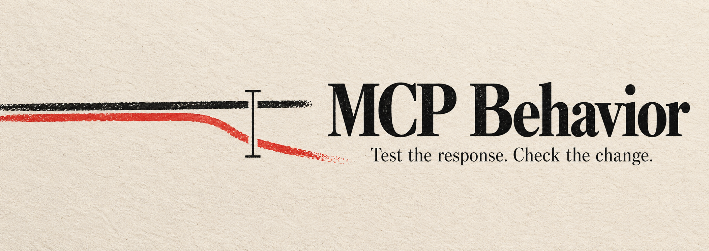

<p align="center">
  
</p>

[](https://github.com/GWeale/mcp-behavior/actions/workflows/ci.yml)
[](LICENSE)

Regression tests for MCP servers. Compare tool responses and declared state changes against another server, a saved baseline, or YAML expectations.

## A successful response can hide a wrong write

A tool returns `saved: true`, but writes **109** instead of the requested **100**. A response check passes. A file assertion catches the mismatch.

See the intentional [wrong-write fixture](examples/wrong-effect/). MCP Behavior checks the effects you declare; it does not discover every side effect.

## Try it

Requires [uv](https://docs.astral.sh/uv/) and Python 3.11+. No API key or existing server needed.

```bash
uvx --from git+https://github.com/GWeale/mcp-behavior.git mcp-behavior demo
```

The demo runs three real checks and removes its temporary files:

```text
MATCH        response only: file total = 109
DIVERGE      response + file state: file total = 109
MATCH        corrected implementation: file total = 100
```

## Test your server

```bash
uv tool install git+https://github.com/GWeale/mcp-behavior.git
mcp-behavior init
```

Edit `mcp-behavior.yaml` with your server command, calls, and assertions, then run:

```bash
mcp-behavior verify mcp-behavior.yaml
```

Add [observers](docs/EFFECTS.md) for files, directory trees, SQLite, or a custom probe. Start from the [complete example](examples/expectations/) or the [contract reference](docs/CONTRACT.md).

| Result | Meaning | Exit |
|---|---|---:|
| `MATCH` | The selected checks agree. | 0 |
| `DIVERGE` | A response or declared effect differs. | 1 |
| `INCONCLUSIVE` | The run could not establish a result. | 2 |

Each run saves evidence and differences. Export reports as JSON, Markdown, or JUnit, or use the [GitHub Action](docs/CI.md) in CI.

## Reference

[CLI](docs/CLI.md) · [Python API](docs/API.md) · [Evidence](docs/EVIDENCE.md) · [Examples](examples/) · [Authenticated HTTP](docs/AUTHENTICATED_HTTP.md) · [Contributing](CONTRIBUTING.md)

Alpha: install from GitHub and pin a commit for reproducible use. Backward compatibility starts with the first versioned release. Configured servers and probes run as trusted code; see [security](docs/SECURITY.md). No telemetry or model calls.
