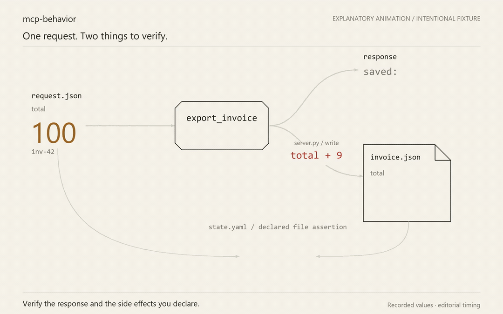

<div align="center">
  <picture>
    <source media="(prefers-color-scheme: dark)" srcset="docs/assets/logo-dark.svg">
    
  </picture>
  <h1>MCP Behavior</h1>
  <p>Test what an MCP tool returns and what it changes.</p>

  [](https://github.com/GWeale/mcp-behavior/actions/workflows/ci.yml)
  [](https://www.python.org/downloads/)
  [](LICENSE)
</div>

Check an MCP server rewrite by comparing responses and declared state changes. Run against another server, a saved baseline, or YAML expectations.

## A successful response can hide a wrong write

This example requests an invoice total of **100**. The tool returns `saved: true`, but writes **109**. A response-only check passes; checking the invoice file catches the error.

<p align="center">
  
</p>

14-second explanatory animation of an intentional fixture. [Watch the MP4](docs/assets/behavior-demo.mp4) · [See the example](examples/wrong-effect/).

## Try the demo

Requires [uv](https://docs.astral.sh/uv/) and Python 3.11+. No API key or existing MCP server needed.

```bash
uvx --from git+https://github.com/GWeale/mcp-behavior.git mcp-behavior demo
```

The command runs three real checks:

```text
MATCH        response only: file total = 109
DIVERGE      response + file state: file total = 109
MATCH        corrected implementation: file total = 100
```

It exits successfully only when all three expected results occur, then removes its temporary files. To keep the reports, use `mcp-behavior demo --evidence demo-evidence` with a new directory.

## Check your own server

Install the current alpha from GitHub and create a starter contract:

```bash
pipx install git+https://github.com/GWeale/mcp-behavior.git
mcp-behavior init
```

Edit `mcp-behavior.yaml` to point at your server and describe a call:

```yaml
version: 1
name: inventory-server

targets:
  candidate:
    transport: stdio
    command: [python, server.py]
    workspace: .mcp-behavior/workspace

scenarios:
  - name: lookup returns the requested item
    calls:
      - tool: lookup
        arguments:
          item_id: item-42
        expect:
          outcome: success
          paths_equal:
            $.structuredContent.id: item-42
```

Then run:

```bash
mcp-behavior verify mcp-behavior.yaml
```

Add explicit [observers](docs/EFFECTS.md) to check files, directory trees, SQLite data, or a trusted custom probe. The [wrong-write example](examples/wrong-effect/mcp-behavior.yaml) shows a complete file assertion.

## Results and workflows

| Result | Meaning | Exit code |
|---|---|---:|
| `MATCH` | The selected checks agree. | 0 |
| `DIVERGE` | A result or declared effect differs. | 1 |
| `INCONCLUSIVE` | The run could not establish a result. | 2 |

Each run saves inspectable evidence: observed values, field-level differences, declared effects, and bounded logs. JSON, Markdown, and JUnit output are available.

| Workflow | Compare against | Example |
|---|---|---|
| Differential | Another live server | [Changed response value](examples/differential/) |
| Baseline | A reviewed JSON recording | [Recorded baseline](examples/baseline/) |
| Expectations | Assertions in YAML | [Call and file assertions](examples/expectations/) |

See the [CLI reference](docs/CLI.md) for recording, comparison options, and report formats.

More examples: [binary files](examples/binary-file/), [Unicode filenames](examples/unicode-files/), and [expected tool errors](examples/expected-error/).

## Use in CI

```yaml
- uses: GWeale/mcp-behavior@main
  with:
    contract: mcp-behavior.yaml
    report: .mcp-behavior/report.xml
```

`main` is the alpha channel. Pin a commit SHA for an immutable version. See the [CI guide](docs/CI.md) for a complete workflow and evidence uploads.

## Scope

MCP Behavior focuses on regression checks during server migrations. It checks the responses and effects you declare; it does not discover every side effect. An ordinary SDK test with the same assertions can catch the same errors. This project packages those checks, comparisons, and evidence into reusable scenarios.

Configured servers, setup commands, and custom probes run as trusted local code. Run untrusted servers in a container, VM, or another suitable sandbox. MCP Behavior has no telemetry or model calls.

## Documentation

- [Contract reference](docs/CONTRACT.md) · [Observable effects](docs/EFFECTS.md) · [Normalization](docs/NORMALIZATION.md)
- [CLI](docs/CLI.md) · [Python API](docs/API.md) · [Evidence](docs/EVIDENCE.md)
- [CI setup](docs/CI.md) · [Troubleshooting](docs/TROUBLESHOOTING.md) · [Security](docs/SECURITY.md)
- [Authenticated HTTP](docs/AUTHENTICATED_HTTP.md) · [External observers](docs/EXTENSIONS.md)
- [Architecture](docs/ARCHITECTURE.md) · [Compatibility](docs/COMPATIBILITY.md) · [Related tools](docs/POSITIONING.md)
- [Contributing](CONTRIBUTING.md) · [Roadmap](ROADMAP.md) · [Provenance](docs/PROVENANCE.md)

This project is an alpha. Backward compatibility starts with the first versioned release.
